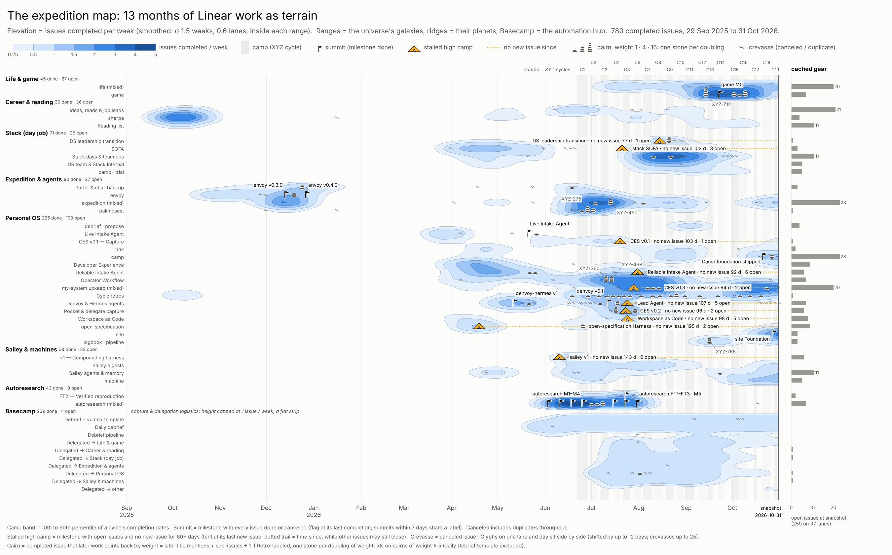
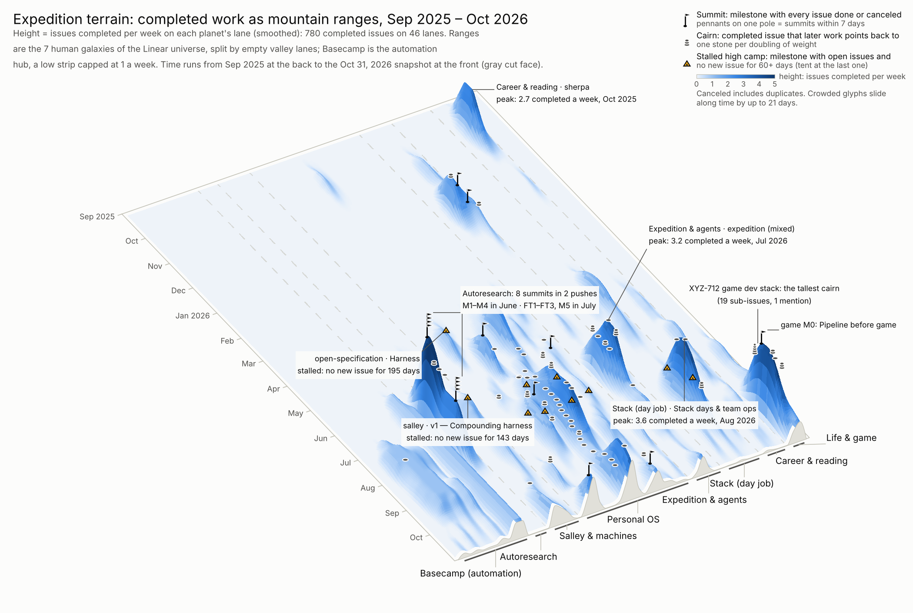
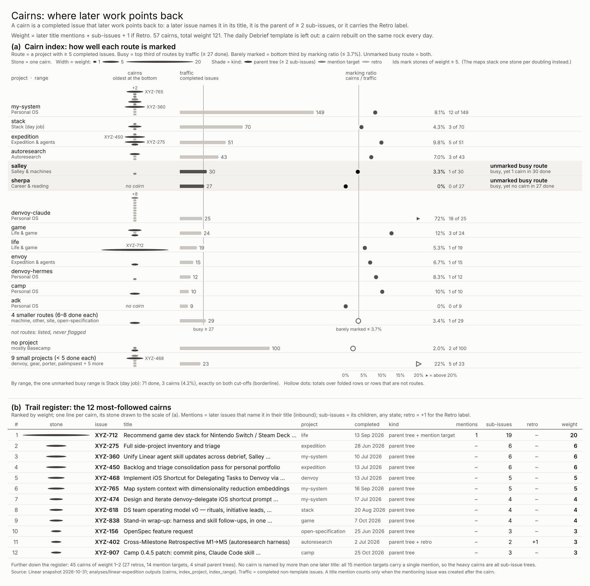

# linear-expedition

Where has the climbing happened, where is the route marked, and where is gear still sitting on the mountain?

## Question

The [universe](../linear-universe/README.md) shows what belongs together, but its positions carry no meaning and
it has no time. This analysis redraws the same Linear work as an expedition, in the workspace's own
vocabulary (expedition, camp, basecamp, sherpa): terrain over time, with summits, camps, stalled high camps
and **cairns** — the markers later work follows.

| On the mountain | In the data |
|---|---|
| Ranges / ridges | the universe's 7 human galaxies / their 46 planets (one lane each, valleys between ranges) |
| Elevation | issues completed per week on a lane, smoothed (σ 1.5 weeks, 0.6 lanes, never across a valley) |
| Basecamp | the automation hub: a low strip capped at 1 a week (logistics, not climbing) |
| Camps | XYZ cycles (19); band = 10th–90th percentile of a cycle's completion dates |
| Summits | milestones with every issue done or canceled (flag at the last completion) |
| Stalled high camps | milestones with open issues and no new issue for 60+ days |
| Cached gear | open issues at the snapshot edge |
| Crevasses | canceled and duplicate issues |
| **Cairns** | completed issues later work points back to: a later title names it, it parents ≥ 2 sub-issues, or it is a retro. Weight = later title mentions + sub-issues + 1 if Retro. The daily Debrief template is left out: a cairn rebuilt on the same rock every day. |

## Answer

Snapshot 2026-10-31: 780 completed issues over 61 weeks, 46 ridges in 8 ranges.

- **The climbing came in two seasons.** A fall-2025 phase (the sherpa push in October, envoy's v0.3.0 and
  v0.4.0 summits in December), a near-empty valley from January to March 2026, then a broad spring-to-fall
  2026 season where almost every range is active at once. The highest peak is Autoresearch (~5 completed a
  week during its June–July pushes, 8 summits in two pushes).
- **16 summits, 10 stalled high camps, 12 milestones still climbing.** The longest-stalled:
  open-specification Harness (no new issue for 195 days, 2 open), salley v1 — Compounding harness (143 d,
  6 open), Lead Agent (107 d, 5 open), CES v0.1 (103 d) and SOFA (102 d, 3 open). Seven of the ten are in
  Personal OS.
- **259 open issues are cached on 37 lanes**, most on expedition (mixed) and camp (23 each), Ideas, reads &
  job leads (21), life and my-system upkeep (20 each).
- **57 cairns, total weight 121:** 27 retros, 16 sub-issue trees, 14 mention targets. The tallest is
  XYZ-712 (game dev stack: 19 sub-issues). The heavy cairns are all sub-issue trees; no cairn is named by
  more than one later title.
- **Best-marked route:** denvoy-claude (18 cairns in 25 completed issues, its cycle retros).
  **Unmarked busy routes:** salley (1 cairn in 30 done) and sherpa (0 in 27). By range, Stack (day job) is
  flagged, but it sits exactly on both cut-offs, so treat it as borderline.

## Evidence



`figures/map-2d.png` — the topographic plan view: time left to right, one lane per planet, contours = weekly
completions. Flags are summits, tents with dotted trails are stalled high camps, stones are cairns (one
stone per doubling of weight; ids on weight ≥ 5), bars at the right edge are open issues.



`figures/terrain-3d.png` — the same surface as shaded relief, time running from the back (Sep 2025) to the
snapshot at the front, with the tallest peaks, the tallest cairn and the longest stalls called out.
An interactive version you can rotate, with titles on hover, is written to `outputs/terrain3d.html`
(6 MB, not committed).



`figures/cairns.png` — (a) the cairn index: per route, cairns stacked as stones next to traffic and the
marking ratio, with unmarked busy routes highlighted; (b) the trail register of the 12 most-followed cairns.

## Method notes and caveats

- **Elevation is throughput, not effort.** Estimates are filled on only a third of issues, so a week of
  three trivial closes is as tall as three hard ones.
- **Lane order is a design choice.** Ranges follow the universe's affinity (the ring opened at its weakest
  link); ridges inside a range put the busiest planet in the middle. Smoothing across neighbouring ridges of
  one range is deliberate (a massif), never across a valley.
- **Glyphs slide to avoid each other:** up to 12 days on the 2D map (canceled marks up to 25) and 21 days in
  3D; both figures say so.
- **Cairn rules count carefully:** a title mention only counts when the mentioning issue was created later
  (10 of 45 mention edges are not), and a sub-issue that names its own parent is counted once, as a child
  (2 cases). The Debrief template (148 issues, 144 completed) is excluded from cairns and from traffic.
- **Cut-offs are tertiles over few groups,** so flags can sit on ties; the index tables carry
  `on_busy_cut` / `on_barely_cut` columns.
- **Stalled uses "no new issue"**, not "no activity": a stalled milestone can still have issues closing.

Code: generic pieces in `src/analytics/` — `features/terrain.py` (week axis, lane tables, per-range
smoothing), `viz/topo.py` (plan view), `viz/relief.py` (3D relief + plotly), `viz/cairns.py` and
`viz/glyphs.py` (stones, flags, tents) — with tests. Linear-specific rules are in `run.py`; the three
figure layouts are in `charts.py`. It reuses linear-universe's galaxy/planet membership, so run that first.

## Rerun

```bash
uv run --extra graph analytics run linear-universe                 # membership the ranges come from
uv run --extra graph --extra viz analytics run linear-expedition   # ~20 s; figures/ + outputs/terrain3d.html
```
