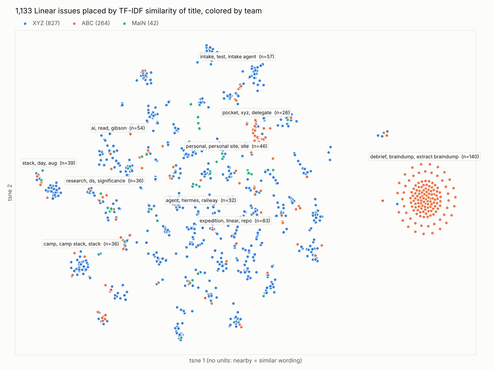

# linear-issue-map

Which kinds of work show up across Linear, judged by how issue titles are worded?

## Question

Do issues group into recognizable themes by their wording, and how do the teams (XYZ = work,
ABC = automation output, MaiN = personal) spread across those themes?

## Answer

Snapshot 2026-10-31, titles only, default config:

- **ABC is mostly one template.** 140 near-identical "Debrief / braindump" issues form the
  isolated ring on the right (98% ABC). Daily debriefs and Pocket/delegate are also mostly ABC.
- **XYZ splits into many clear themes:** intake-agent tests (57), research/significance (36),
  personal site (46), camp stack (36), stack-day (39), cycle retros (25, all XYZ),
  Hermes/Railway agents (32), plus smaller Mac mini, Envoy, Cursor cloud and Career Sherpa groups.
- **MaiN doesn't cluster.** Personal tasks rarely repeat wording.
- **280 issues are unclustered** (one-off wording), and 10 can't be placed at all because no word
  in their title appears in any other title (e.g. "Tattoo", hash-only titles).
- The "expedition, linear, repo" group (83) is a loose catch-all, not one theme.

## Evidence



`figures/tfidf_scatter_titles.png`: 1,133 issues, colored by team, 10 largest clusters labeled.
Nearby dots have similar titles; distances between far-apart groups and the axes mean nothing.

## Method

1. **Text** (`[tfidf] text_fields`): the title by default; labels, project, etc. can be added.
2. **TF-IDF**: letters-only words and word pairs that appear in at least 2 issues
   (`min_df`), English stop words removed, sublinear term frequency. 1,366 terms.
3. **LSA**: truncated SVD to 50 dimensions, each vector scaled to length 1. Issues with no
   terms are left unplaced.
4. **t-SNE** (`[embed]`): cosine distance, perplexity 30, seed 42, gives the 2D layout.
   Near-identical titles can't stack, so they spread into a ring (the debriefs).
5. **HDBSCAN** (`[cluster]`): on the 2D layout, minimum cluster size 15; -1 = unclustered.
   K-means in LSA space was tried first; its groups scattered across the 2D map.
6. **Names**: each cluster's top 3 mean-TF-IDF terms.
7. **Plot** (`[plot]`): one dot per issue colored by team; 10 largest clusters labeled.

Shared code: `analytics.features.text` (steps 2-6) and `analytics.viz.scatter` (step 7).
Outputs land in `outputs/` (git-ignored): `issues.parquet` with every raw column plus
`x_random`, `y_random`, `x_tfidf`, `y_tfidf`, `tfidf_cluster`, `tfidf_cluster_terms`,
`tfidf_top_terms`, `tfidf_nnz`, `n_labels`, `days_to_complete`; the TF-IDF matrix
(`tfidf.npz`, `tfidf_meta.json`); both plots; and `run_config.json`.

## Rerun

```bash
uv run analytics fetch linear                       # refresh the snapshot (needs LINEAR_KEY)
uv run analytics run linear-issue-map
uv run analytics run linear-issue-map --set 'tfidf.text_fields=["title","labels","project"]'
```

## Next

- **Done:** [linear-universe](../linear-universe/README.md) consolidates these clusters into galaxies and
  planets using projects, milestones, labels and sub-issue links.
- Add labels and project to the text to firm up the loose middle.
- Exclude templated ABC debriefs (`--set 'filter.teams=["XYZ","MaiN"]'`) to see the rest more clearly.
- Try semantic embeddings (`uv sync --extra embeddings`) once TF-IDF limits are clear.
