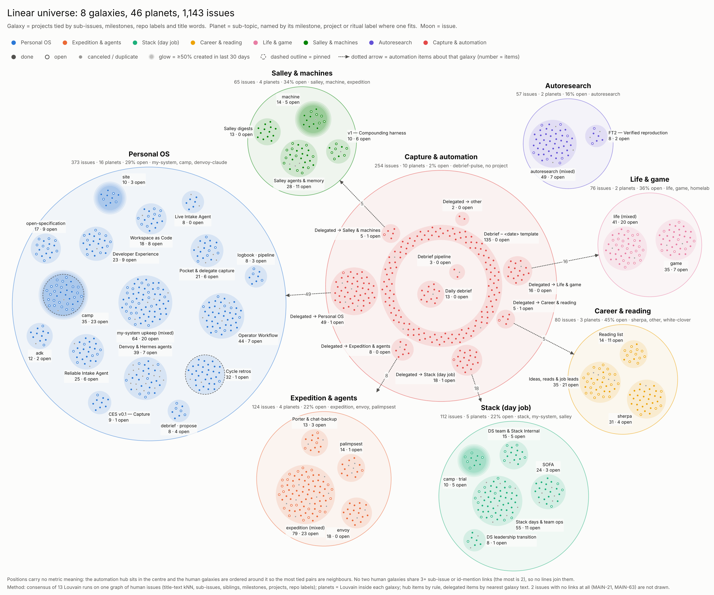

# linear-universe

How does all of Linear's work group into larger areas, once projects, milestones, labels and links between issues are used alongside title wording?

## Question

The title-only map ([linear-issue-map](../linear-issue-map/README.md)) finds 25 text clusters, but many are loose
and big projects spread across a dozen of them. Can the other fields consolidate those clusters into a few
**galaxies** (areas of work) made of **planets** (sub-topics) made of **moons** (issues), and what does that
picture say?

## Answer

Snapshot 2026-10-31, default config: **8 galaxies, 46 planets, 1,143 issues.**

- **Automation is a quarter of the universe and almost all closed.** The *Capture & automation* hub holds
  254 issues (2% open): 135 `Debrief – <date>` template issues, a retired *Daily debrief* template (last
  issue 2026-06-14, replaced two days later), and 103 delegated or captured items.
- **Delegated items mostly serve the Personal OS itself.** By nearest text, they're about Personal OS 49,
  Stack 18, Life & game 16, Expedition 8, Salley 5, Career 5. About 43% of these routes are low-confidence.
- **Personal OS is 42% of human work** (373 of 889 issues, 16 planets), and five of the six borderline
  ("satellite") project groups attach to it.
- **Human galaxies are nearly closed.** Only 7 sub-issue or id-mention links cross between them (at most
  2 per pair).
- **Camp is the active frontier.** camp, site, machine and camp · trial are mostly created in the last 30 days.
- **Stalled planets** (no new issue in 60+ days, still open work): v1 — Compounding harness (6 of 10 open,
  idle 143 d), open-specification (9 of 17, 127 d), Porter & chat-backup, SOFA, FT2, Reliable Intake Agent,
  Denvoy & Hermes agents, DS leadership transition.
- **Galaxies are project families, not discovered topics.** Remove the project field and galaxies change
  almost entirely (ARI 0.28). Planets are where the other fields add shape (see ablation).

## Evidence



`figures/universe.png`: the automation hub sits in the centre; the seven human galaxies sit on a ring,
ordered so the most-tied pairs are neighbours. Each planet's area is proportional to its issues; moons
are filled when done, hollow when open, small gray when canceled or duplicate. Dashed outlines are pinned
planets (judgement calls); a glow means at least half the planet was created in the last 30 days; dotted
arrows show which galaxy delegated items are about. **Positions carry no metric meaning.**

### What each data element adds (one-field ablation)

Each row drops one edge type and rebuilds everything. ARI against the full build, on the 889 human issues
(1.0 = unchanged).

| dropped | galaxy ARI | planet ARI | planets | sub-issue pairs kept in one planet |
|---|---|---|---|---|
| nothing (full) | 1.00 | 1.00 | 46 | 0.97 |
| project | **0.28** | **0.42** | 52 | 0.98 |
| title text | 0.82 | 0.75 | 39 | 0.98 |
| parent (sub-issues) | 0.88 | 0.76 | 46 | **0.58** |
| milestone | 0.98 | **0.58** | 49 | 0.98 |
| repo label | 0.96 | 0.75 | 46 | 0.97 |
| sibling | 0.99 | 0.87 | 50 | 0.94 |

- **Project** is the backbone at both levels.
- **Title text** is the second force for galaxies; without it planets merge (39, five over 50 issues).
- **Milestones** barely move galaxies but carve planets.
- **Sub-issue links** keep trees whole (0.97 vs 0.58) and hold *Life & game* together: 19 of its 76 issues
  are children of XYZ-712.
- **Repo labels** shape planets more than galaxies; **siblings** add little beyond parent links.
- **Work-type labels** (Improvement, Feature, Documentation) were measured and left out: they're
  unrelated to topic (AMI 0.04 against text clusters).

### Stability

- Galaxies are a consensus of 13 Louvain runs: single seeds agree with it at ARI 0.99 (min 0.96), all
  giving 8 galaxies. Planets across seeds: 0.94 (min 0.89).
- 90% subsamples (5 full rebuilds): galaxies 0.90 (min 0.78), planets 0.87 (min 0.86). What moves:
  *Life & game* can dissolve into Personal OS through a 1.08x near-tie, and the Personal OS / Expedition
  border can split.

### Held-out checks

Two kinds of links were kept out of the graph and used to test it:

- **Creation sessions** (same team, created within 5 minutes; 527 human pairs): 80% share a galaxy and 60%
  a planet, against 24% and 4% for random pairs. Most of that is shared projects; for the 141 cross-project
  pairs it is 28% vs 15% (galaxy) and 12% vs 0.5% (planet).
- **Title id-mentions** (e.g. "… → XYZ-910"; 23 human pairs): 74% share a galaxy, 52% a planet.
- For delegated items that mention an issue id, text routing picks that issue's galaxy 13 of 18 times.

### Judgement calls (visible in the chart)

- **Pinned:** *camp* → Personal OS (its titles are Camp-tool work; by affinity it would sit with Stack at
  1.20x over Expedition), and the *denvoy-claude* group → Personal OS (a 1.02x coin flip; its sibling
  projects are there). Pins only apply to near-ties (< 1.25x) or listed required pins.
- **Left to affinity:** site (near-tie, 1.23x) and adk (1.30x) → Personal OS.
- **(mixed) planets** (mean title similarity < 0.22): expedition 79, my-system upkeep 64, autoresearch 49,
  life 41 — single-project grab-bags with no milestone or sub-issue structure to split them.
- **Not drawn:** MAIN-21 and MAIN-63, which have no links of any kind.

## Method

1. **Hub by rule.** debrief-pulse plus every project-less ABC issue form *Capture & automation*. They're set
   aside before the graph: with them in it, single Louvain seeds swung to ARI 0.64 because these items
   bridge galaxies.
2. **One issue graph** on the 889 human issues with six weighted edge layers: title-text kNN (TF-IDF cosine,
   10 neighbours), project, milestone, parent, sibling and repo label (`[edges]`).
3. **Galaxies:** Louvain (resolution 0.5) for seeds 0-12, then a consensus on the co-assignment share
   (≥ 0.5). Communities under 40 issues are satellites that join the galaxy with the highest normalized
   affinity, or a pin on near-ties.
4. **Planets:** Louvain inside each galaxy (min 8 issues); a planet over 50 issues is split again only if
   the split reaches modularity 0.2.
5. **Hub planets:** the template belt, Daily debrief, and *Delegated → <galaxy>*, routed by nearest
   galaxy text centroid (targets under 5 items merge into *other*).
6. **Names** (two-thirds of human issues land in planets named by your own milestone, ritual label or
   project; 8 planets use a short override map): milestone (≥ 40% of the planet) → ritual label (≥ 60%) → project → a short override map →
   distinctive title terms; *(mixed)* when cohesion is low. Galaxy names come from a theme map keyed by
   lead project, falling back to project names if membership changes.
7. **Chart:** packed circles at one fixed scale, labels placed outside discs by a collision-repair loop.

Shared code: `analytics.features.graph` (edges, Louvain consensus, absorb, split) and
`analytics.viz.universe` (packing and the chart). Linear-specific rules live in `run.py`; the validation
suite (stability, subsamples, held-out checks, ablation) is in `checks.py`.

This design was chosen over two alternatives that were prototyped and judged: galaxies anchored on
hand-merged projects (best galaxy names, weakest planets) and one multi-view feature space cut at two
levels (stable, but produced a 363-issue grab-bag galaxy). See [docs/lessons.md](../../docs/lessons.md).

## Rerun

```bash
uv sync --extra graph                                                          # networkx for Louvain
uv run --extra graph analytics run linear-universe                             # ~40 s
uv run --extra graph analytics run linear-universe --set checks.enabled=true   # + validation suite, ~2 min
cp analyses/linear-universe/outputs/universe.png analyses/linear-universe/figures/  # refresh the figure
```

`run.py` is ~360 lines, over the ~100-line aim in AGENTS.md: the hub rule, pins and naming are Linear-specific
and read best top to bottom as one pipeline. Everything reusable (graph communities, packing, the chart) is in
`src/analytics/`. The chart refuses more than 8 galaxies (one palette color each); raise
`galaxies.min_size` or lower `galaxies.resolution` if a config change produces more.

## Next

- Improve delegated-item routing with the id-mentions in their titles before falling back to text.
- Split the four *(mixed)* planets with labels or descriptions (titles alone are too sparse).
- A video walkthrough of the method and the universe (separate PR).
